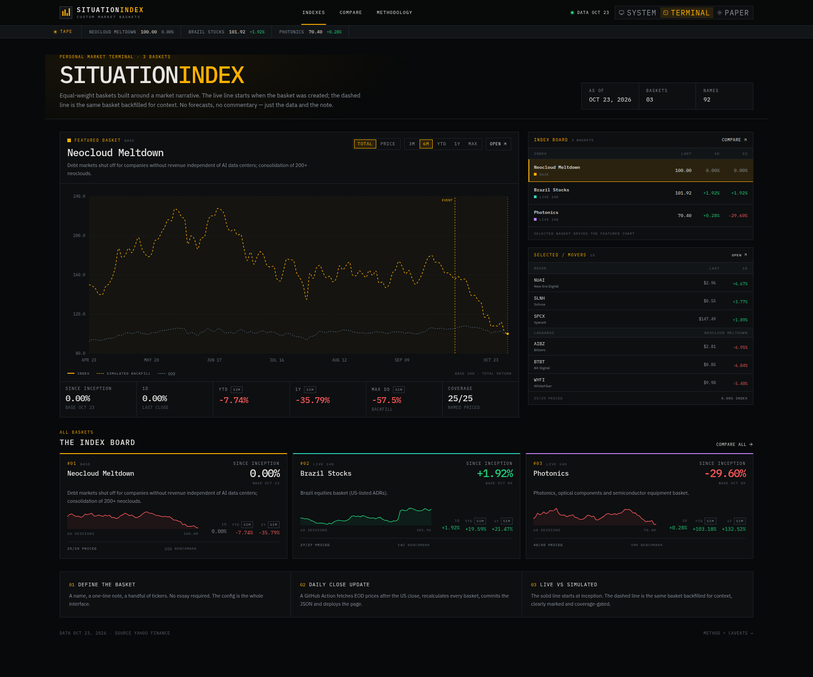

# Situation Index

A personal market terminal for tracking **custom equal-weight baskets** built around a market situation — with daily data, charts, constituent tables, and a clear line between the live record and the simulated backfill.

**Live:** https://jorgequijano.github.io/situation-index/



## What is in here

- **Neocloud Meltdown** — debt markets shut off for companies without revenue independent of AI data centers; consolidation of 200+ neoclouds.
- **Brazil Stocks** — Brazil equities basket (US-listed ADRs).
- **Photonics** — photonics, optical components and semiconductor equipment.

The seed lists come from Lin [@speculator_io](https://x.com/speculator_io) and are tracked here for personal research. This project is not affiliated with him.

## Stack

- Vite + React 19 + TypeScript
- Tailwind CSS v4
- Recharts for the index, comparison and drawdown charts
- IBM Plex Sans / IBM Plex Mono
- GitHub Actions for the daily market-data refresh
- GitHub Pages for static hosting

## How the data works

There is **no database server and no SQL connection**. GitHub Pages only serves static files, so the repository is the database:

```text
data/indexes/*.yml          ← basket definitions
        │
        ▼
scripts/update-data.ts      ← fetch EOD bars, calculate indexes
        │
        ▼
public/data/manifest.json   ← homepage summaries
public/data/indexes/*.json  ← full series + constituents
        │
        ▼
GitHub Actions              ← daily refresh + commit + build + deploy
```

The update workflow runs after the US close (`00:30 UTC` Tuesday–Saturday) and on manual dispatch. It fetches daily bars from Yahoo Finance, writes compact JSON, commits the change and deploys the static site. A data failure keeps the last committed data and fails the run after deployment, so the site does not disappear.

## Index method

- Equal weight, daily rebalanced, in USD.
- Base 100 at the **base date** (`inception`, or the next trading session).
- **Total return** uses adjusted close (dividends and splits included); **price return** uses close. Both are stored.
- Foreign listings are converted with daily FX (`EURUSD`, `GBPUSD`, `SEKUSD`). Pence (`GBp`) is divided by 100 before conversion.
- The pre-inception line is a **simulated backfill** using today's constituents, drawn dashed and labelled as such. The live line starts at the base date.
- The **MAX** range starts at `coverage_start`: the first date where at least 60% of the basket has data for ten consecutive sessions. This keeps a thin 2021 backfill from masquerading as the whole basket.

The backfill is **not a live track record**. It has hindsight/selection bias and no transaction costs. Read the notes in the app's Methodology page.

## Adding a basket

Create a YAML file in `data/indexes/`. The `slug` is the URL. No application code changes are needed.

```yaml
name: New Situation
slug: new-situation
created: 2026-10-26
inception: 2026-10-26
event_date: 2026-10-01        # optional
event_label: What happened   # optional
backfill_start: 2024-10-26
min_coverage: 0.6
benchmark: SPY
color: "#60a5fa"
note: One line reminder of the situation.
constituents:
  - { symbol: AAPL, name: Apple }
  - { symbol: MSFT, name: Microsoft }
```

Use `ticker:` when the display ticker differs from the provider symbol:

```yaml
- { symbol: SID, ticker: CSN, name: CSN }
- { symbol: SIVE.ST, ticker: SIVE, name: Sivers Semiconductors }
```

Then run **Actions → Update data and deploy → Run workflow**, or wait for the nightly run. It will validate the symbols, backfill the history and deploy.

## Local development

```sh
npm install
npm run dev          # http://localhost:5173/
npm run data:update  # refresh Yahoo Finance data
npm test             # index math tests
npm run build        # typecheck + production build
npm run preview      # serve dist/
```

The Yahoo chart endpoint is free but unofficial, so the updater retries both Yahoo hosts and keeps last-good data on failure. The provider layer is isolated in `scripts/lib/yahoo.ts` if a Tiingo/FMP fallback is added later.

## Theme

- **System** (default) follows the OS.
- **Terminal** is the dark Bloomberg-style theme.
- **Paper** is the warm light theme.
- You can force a theme for a link/screenshot with `?theme=terminal` or `?theme=paper`.

## Caveats

- Personal research tool. **Not investment advice.**
- Backfilled history is simulated; coverage is shown on every index.
- Yahoo Finance data can be delayed, revised or briefly unavailable.
- The index is not investable: no fees, slippage, taxes or borrow costs.
- A public repository means the basket definitions and data are public.
